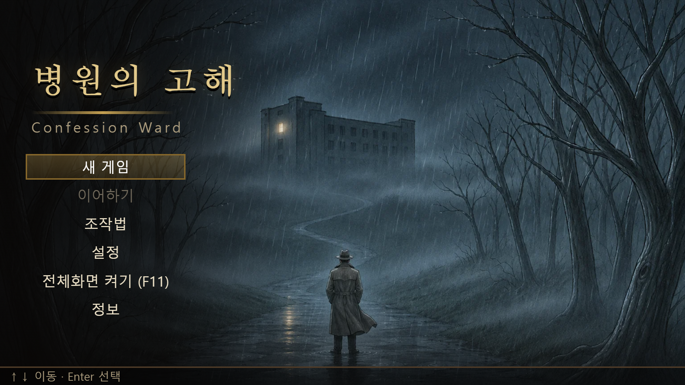
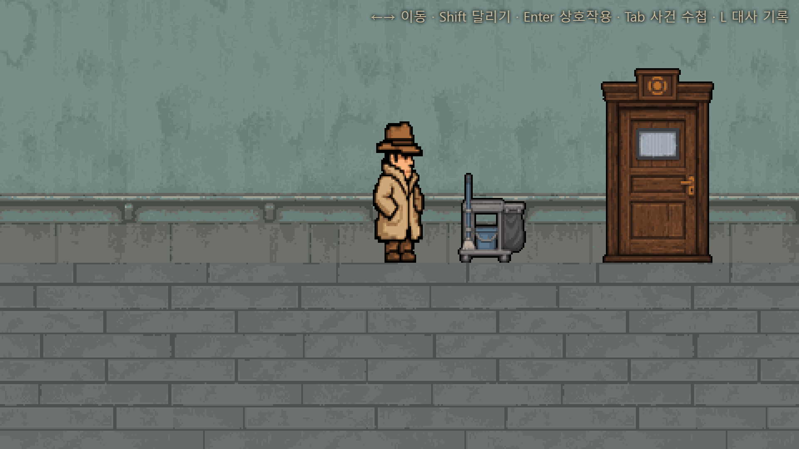

# 병원의 고해 (Confession Ward)

> 실종된 동생을 찾아 폐쇄적인 종교 병원에 온 탐정이, 원장의 죽음 뒤에 숨은 범죄를 증거로 밝혀내는 픽셀 추리 어드벤처

## 팀원 소개

| 이름 | 역할 | GitHub |
|---|---|---|
| TODO (마감 때 작성) | TODO | TODO |

## 게임 소개

- **장르**: 2D 픽셀 스토리 추리 어드벤처 (심리 스릴러)
- **플레이 시간**: 약 30분, 엔딩 4종
- **재미 포인트**:
  - 픽셀 병원을 오가며 현장을 조사하고, 증거를 들이밀어 진술의 모순을 깨는 심문
  - 공간·시간·문서·관계·논리표를 다루는 층별 추리 퍼즐 5종
  - 물증·기록·증언을 엮어 네 가지 경쟁 가설을 증명하는 최종 보고서
  - 증거를 지켜내느냐에 따라 달라지는 결말

## 조작법

| 키 | 동작 |
|---|---|
| `←` `→` / `A` `D` | 이동 |
| `Shift` | 달리기 |
| `Enter` | 상호작용 · 대사 넘기기 · 선택 |
| `Tab` | 사건 수첩 열기 / 닫기 |
| `L` | 이 구역에서 본 대사 다시 읽기 |
| `Esc` | 닫기 · 취소 |
| `M` | 소리 켜기 / 끄기 |
| `F11` | 전체 화면 (타이틀·설정의 "전체화면"도 같다) |
| `마우스` | 근접 조사 · 퍼즐 드래그 · 클릭 |

## 스크린샷

(최종 촬영 예정 — `screenshots/` 에 `main.png`, `play.png` 등을 넣고 아래 줄의 주석을 푼다)
<!--   -->

## ⬇️ 다운로드

[게임 다운로드 (v1.0)](https://github.com/bangsiru0606/pubg/releases/tag/v1.0)

## ▶️ 실행 방법

zip 압축 해제 후 `index.html` 더블클릭으로 실행 (Chrome / Edge 권장)

## 사용 도구와 출처

<!-- credits:start (npm run readme:credits 가 이 구간을 다시 쓴다) -->
- **그림**: Codex(`$imagegen`)로 생성. 탐색 화면의 기준 그림체는 craft_on 기존 에셋.
- **개발**: Claude Code, Codex
- **효과음**: 코드로 직접 합성 (외부 음원 없음)
- **배경음악** (곡별 출처):
  - bgm_title: ElevenLabs Music (Eleven Music v2.5, 무료 플랜), 2026-11-11
  - bgm_office: ElevenLabs Music (Eleven Music v2.5, 무료 플랜), 2026-11-11
  - bgm_hospital: ElevenLabs Music (Eleven Music v2.5, 무료 플랜), 2026-11-11
  - bgm_interrogation: ElevenLabs Music (Eleven Music v2.5, 무료 플랜), 2026-11-11
  - bgm_basement: ElevenLabs Music (Eleven Music v2.5, 무료 플랜), 2026-11-11
  - bgm_confession: ElevenLabs Music (Eleven Music v2.5, 무료 플랜), 2026-11-11
  - bgm_report: ElevenLabs Music (Eleven Music v2.5, 무료 플랜), 2026-11-11
  - bgm_ending_light: ElevenLabs Music (Eleven Music v2.5, 무료 플랜), 2026-11-11
  - bgm_ending_dark: ElevenLabs Music (Eleven Music v2.5, 무료 플랜), 2026-11-11
  - 배경음악은 Eleven Music(ElevenLabs 무료 플랜)으로 생성했다. 비상업적 이용.
<!-- credits:end -->

---

<details>
<summary>개발자용</summary>

```bash
npm install
npm run dev
```

- 기획서: [`docs/기획서_보정판.md`](docs/기획서_보정판.md)
- 개발 계획: [`docs/이전계획.md`](docs/이전계획.md)
- 제출 체크리스트: [`docs/제출_체크리스트.md`](docs/제출_체크리스트.md)
- 사운드 계획: [`docs/사운드_계획.md`](docs/사운드_계획.md)

</details>
